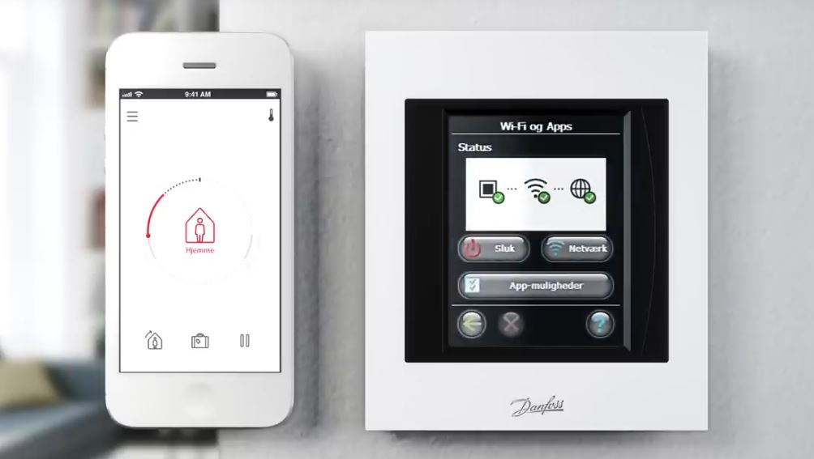
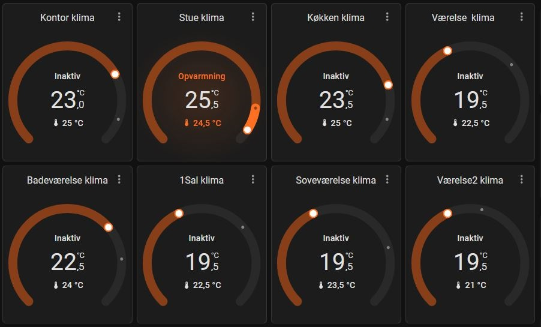
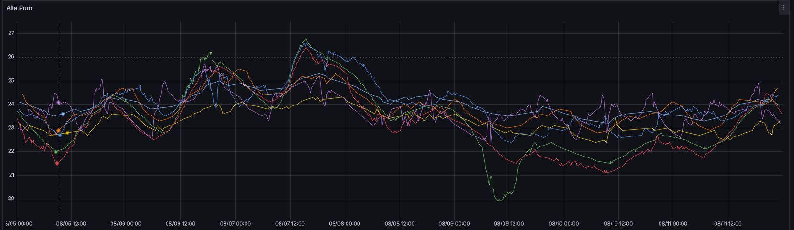

# 🌡️ Danfoss Link CC → Home Assistant

Integrér dit **Danfoss Link CC** varmesystem i Home Assistant via Alexa og Node-RED – uden officiel API!



---

## 📋 Indhold

- [Hvad gør dette?](#-hvad-gør-dette)
- [Primær vejledning](#-primær-vejledning)
  - [Krav](#✅-krav)
  - [Installation](#🚀-installation)
  - [Konfiguration](#⚙️-konfiguration)
- [Dokumentation](#-dokumentation)
- [Kendte begrænsninger](#-kendte-begrænsninger)
- [Screenshots](#-screenshots)
- [Bidrag & Support](#-bidrag--support)
- [Licens](#-licens)

---

## 💡 Hvad gør dette?

Dette projekt lader dig trække temperaturdata fra din **Danfoss Link CC controller** ind i Home Assistant – selvom Danfoss ikke tilbyder en officiel integration.

**Datavej:**
```
Danfoss Link CC → Alexa → Node-RED → Home Assistant
```

Når det er sat op, kan du:
- 📊 Se aktuel og ønsket temperatur pr. rum i HA
- 🤖 Lave automatiseringer baseret på rumtemperatur
- 📈 Vise historisk temperaturdata i Grafana
- 🔄 Automatisk opdatering hvert 5. minut

---

## 📚 Primær vejledning

### ✅ Krav

| Komponent | Detaljer |
|-----------|----------|
| **Danfoss Link CC** | Tilsluttet til internet |
| **Amazon Alexa app** | Gratis – ingen fysisk Alexa-enhed nødvendig |
| **Home Assistant** | Installeret og kørende |
| **Node-RED** | Installeret som HA addon eller standalone |

**Node-RED paletter (skal installeres):**
- [`node-red-contrib-home-assistant-websocket`](https://flows.nodered.org/node/node-red-contrib-home-assistant-websocket)
- [`node-red-contrib-alexa-remote2-applestrudel`](https://flows.nodered.org/node/node-red-contrib-alexa-remote2-applestrudel)

### 🚀 Installation (Hurtigguide)

1. **Tilslut Danfoss til Alexa** – Se [docs/SETUP_ALEXA.md](docs/SETUP_ALEXA.md)
2. **Installer Node-RED paletter** – Se [docs/INSTALLATION.md](docs/INSTALLATION.md#trin-2--installer-node-red-paletter)
3. **Importer flow** – Copy/paste fra `flows/danfoss-link-integration.json`
4. **Konfigurér rum** – Tilføj dine rum som beskrevet i guiden
5. **Deploy og test** – Verificer at data kommer ind i Home Assistant

👉 **Detaljeret vejledning:** Se [docs/INSTALLATION.md](docs/INSTALLATION.md)

### ⚙️ Konfiguration

Vil du:
- ➕ Tilføje flere rooms (8+ rum)?
- ⏱️ Ændre update-frekvens?
- 📊 Sætte Grafana op?
- 🔗 Lave Home Assistant automations?

👉 Se [docs/CONFIGURATION.md](docs/CONFIGURATION.md)

---

## 📚 Dokumentation

| Dokument | Indhold |
|----------|---------|
| [INSTALLATION.md](docs/INSTALLATION.md) | Trin-for-trin installationsvejledning |
| [SETUP_ALEXA.md](docs/SETUP_ALEXA.md) | Opsætning af Alexa integration |
| [CONFIGURATION.md](docs/CONFIGURATION.md) | Avanceret konfiguration & tilpasning |
| [TROUBLESHOOTING.md](docs/TROUBLESHOOTING.md) | Fejlfinding & løsninger |
| [danfossAlexaSetup.pdf](docs/danfossAlexaSetup.pdf) | PDF vejledning til Alexa |

---

## ⚠️ Kendte begrænsninger

- **5 minutters polling** – Alexa tillader kun datahentning hvert 5. minut (realtidsdata ikke muligt)
- **Cloudafhængighed** – Løsningen er afhængig af Amazons API
- **8 rooms standard** – Default setup understøtter 8 rum (kan udvides, se [CONFIGURATION.md](docs/CONFIGURATION.md))

---

## 📸 Screenshots

| Home Assistant | Grafana |
|----------------|---------|
|  |  |

---

## 📁 Projektstruktur

```
danfosslink-in-HA/
├── README.md              ← Du er her
├── CHANGELOG.md           ← Version history
├── LICENSE                ← MIT License
│
├── flows/
│   └── danfoss-link-integration.json    ← Node-RED flow
│
├── docs/
│   ├── INSTALLATION.md    ← Detaljeret setup vejledning
│   ├── SETUP_ALEXA.md     ← Alexa opsætning
│   ├── CONFIGURATION.md   ← Avanceret konfiguration
│   ├── TROUBLESHOOTING.md ← Fejlfinding
│   └── danfossAlexaSetup.pdf
│
├── assets/
│   ├── danfosslink.JPG
│   ├── grafanaTemp.JPG
│   ├── haKlima.JPG
│   └── ...
│
└── config/
    ├── example-ha-automation.yaml
    └── example-grafana-dashboard.json
```

---

## 🤝 Bidrag & Support

Har du problemer eller forbedringer?

1. **Læs først:** [TROUBLESHOOTING.md](docs/TROUBLESHOOTING.md)
2. **Åbn issue:** [GitHub Issues](https://github.com/michaelflarsen/danfosslink-in-HA/issues)
3. **Pull Request:** Er velkommen!

---

## 📜 Licens

MIT License – se [LICENSE](LICENSE) fil for detaljer.

---

**Made with ❤️ for Home Assistant** • [GitHub](https://github.com/michaelflarsen/danfosslink-in-HA)
